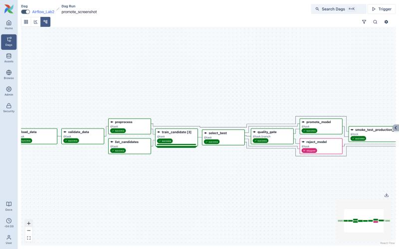
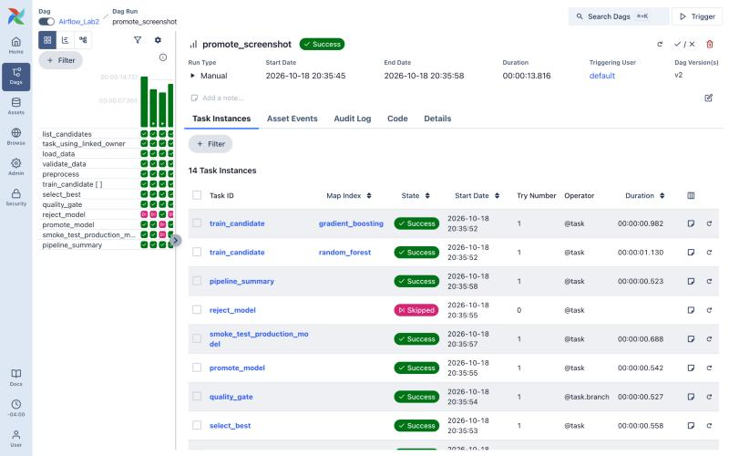
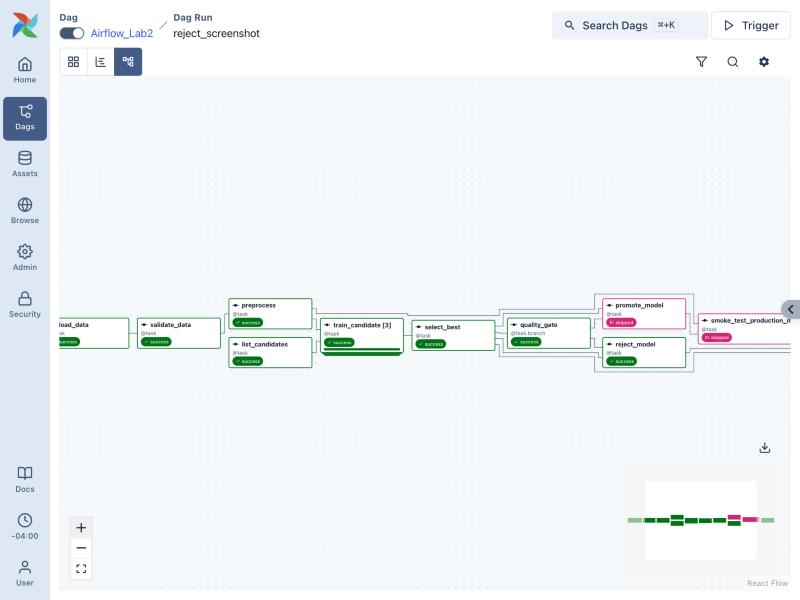
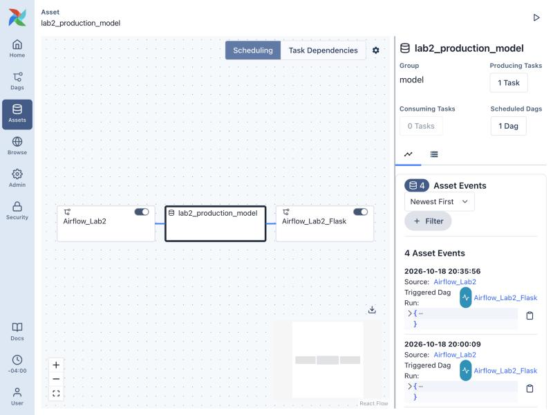
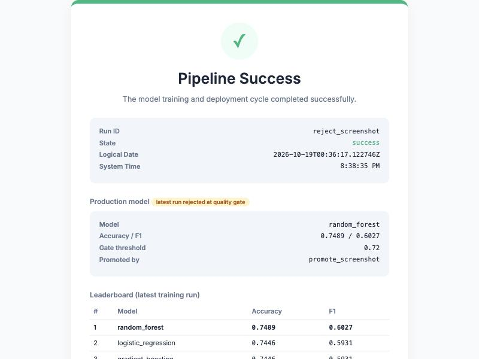

# Airflow Lab 2: Multi-Model Training Pipeline with a Quality Gate

**Author:** Karuniya Premnath ([@karunprem45](https://github.com/karunprem45))<br>
**Course:** IE7374 MLOps, Northeastern University, Fall 2026

This is my version of [MLOps Airflow Lab 2](https://github.com/raminmohammadi/MLOps/tree/main/Labs/Airflow_Labs/Lab_2).
In the original lab, one DAG trains a single logistic-regression model and then
pushes a second DAG that serves a Flask status page.

I redesigned the **orchestration** (how Airflow runs the work), not just the
model. The pipeline now:

- trains several models **in parallel** (dynamic task mapping)
- picks the best one
- uses a **branching quality gate** to decide whether that model goes to production
- tells the serving DAG about it through an **Airflow 3 Asset** (data-aware
  scheduling) instead of `TriggerDagRunOperator`

The pipeline predicts diabetes from the **Pima Indians Diabetes** dataset
(768 patients, 8 medical measurements). It comes with **24 pytest tests**
covering the ML code and the DAG wiring. [Screenshots of a working run](#screenshots)
are at the end of section 4.

The whole stack runs in Docker, so the only thing you need to install is Docker.

---

## 1. What you need to install

| Tool | Version used | Notes |
|---|---|---|
| [Docker Desktop](https://www.docker.com/products/docker-desktop/) (macOS / Windows) or Docker Engine (Linux) | Docker 29.6, Compose v5.3 | Any Docker with `docker compose` (Compose v2+) works. Give Docker **at least 4 GB of memory** (Docker Desktop → Settings → Resources). |
| git | any | Only needed to clone this repo. macOS: run `xcode-select --install`. Windows: [git-scm.com](https://git-scm.com/download/win). No git? On GitHub click **Code → Download ZIP**, unzip it, and `cd` into the `airflow-lab2-main` folder instead. |

You do **not** need Python or Airflow on your machine. These run inside the containers:

| Component | Version |
|---|---|
| Apache Airflow (`apache/airflow` image) | **3.3.2**, CeleryExecutor |
| Python (inside the image) | 3.13 |
| PostgreSQL / Redis | 16 / 7.2 (from the official compose file) |
| scikit-learn / pandas / flask / numpy / requests | 1.9.1 / 3.0.5 / 3.1.3 / 2.5.3 / 2.34.2, all pinned in `requirements.txt` and installed at container start |
| pytest | 9.1.1, pinned in `requirements-dev.txt` and installed only when you run the tests |

Ports **8080** (Airflow UI) and **5555** (Flask status page) must be free.

---

## 2. Set up

```bash
git clone https://github.com/karunprem45/airflow-lab2.git
cd airflow-lab2
./setup.sh
```

If `./setup.sh` says `permission denied`, run `bash setup.sh` instead.

`setup.sh` does three things:

1. Creates the folders Airflow mounts: `logs/`, `plugins/`, `config/`, `working_data/`, `model/`.
2. Creates `.env` from `.env.example` and sets `AIRFLOW_UID` to your user id,
   so files written by Airflow are owned by you.
3. Runs `docker compose up airflow-init`, which pulls the images, creates the
   metadata database, and creates the login **airflow / airflow**.

The first run downloads about 1.5 GB of images (about 4 GB once unpacked) and can take several minutes.
It's finished when you see `airflow-init-1 exited with code 0`.

On Windows, run the same commands in WSL2, or run the three steps from
`setup.sh` by hand.

---

## 3. Run it

### 3.1 Start Airflow

```bash
docker compose up -d
docker compose ps
```

Wait until every service shows `(healthy)`. This takes about 1–2 minutes,
because the containers install the Python packages at start-up.

### 3.2 Run the pipeline from the UI

1. Open http://localhost:8080 and log in with `airflow` / `airflow`.
2. Find **Airflow_Lab2** and switch on its toggle (it starts paused).
   Turning it on queues one scheduled run straight away. That's expected.
3. Click **Trigger** to start a manual run. A form opens with the run parameters:

| Param | Default | Meaning |
|---|---|---|
| `min_accuracy` | `0.72` | The best model must reach this test accuracy to be promoted. |
| `test_size` | `0.3` | Share of rows held out for testing. |
| `models` | all three | Which candidate models to train. Each one becomes its own parallel task. |

4. Leave the defaults and trigger the run.

### 3.3 Or run it from the command line

```bash
docker compose exec airflow-scheduler airflow dags unpause Airflow_Lab2

# Promote path: default threshold 0.72
docker compose exec airflow-scheduler airflow dags trigger Airflow_Lab2 --run-id promote_demo

# Reject path: a threshold no model reaches
docker compose exec airflow-scheduler airflow dags trigger Airflow_Lab2 --run-id reject_demo \
  --conf '{"min_accuracy": 0.80}'
```

### 3.4 Look at the result

- Status page: http://localhost:5555 (redirects to `/success` or `/failure`)
- JSON status: http://localhost:5555/api/status
- Files on disk: `model/leaderboard.json`, `model/production/model.sav`, `model/production/metadata.json`

### 3.5 Run the tests

The tests run inside the worker container, because they need the same
Airflow and Python versions as the pipeline. Airflow must be running (step 3.1).

```bash
docker compose exec airflow-worker bash -c "python -m pip install -q -r /opt/airflow/requirements-dev.txt && cd /opt/airflow && python -m pytest tests -v"
```

✅ The last line should be `24 passed`. The tests write to a temporary folder,
so they never overwrite your real `model/` or `working_data/` files.

| File | What it checks |
|---|---|
| `tests/test_model_development.py` (13 tests) | Loading the CSV; `validate_data` accepts good data and rejects 4 kinds of bad data (missing column, too few rows, nulls, non-binary target); the 70/30 split is stratified; impossible zeros are imputed so no NaN reaches the models; every candidate model beats the 0.65 "always say no" baseline; leaderboard ranking with F1 as tie-breaker; the promoted model reloads with the same score |
| `tests/test_dags.py` (11 tests) | Both DAGs import with no errors; all 12 tasks exist; `train_candidate` is dynamically mapped; `quality_gate` branches to promote/reject and decides correctly at, above and below 0.72; `pipeline_summary` runs after either branch; param defaults; retries, timeouts and failure callbacks on every task; the Asset links `promote_model` to the Flask DAG's schedule |

### 3.6 Stop

```bash
docker compose down        # stop and keep the database
docker compose down -v     # stop and delete the database too (fresh start next time)
```

---

## 4. What a successful run looks like

**Promote run (default params).** In the Grid view of `Airflow_Lab2`, every task
is green except `reject_model`, which is pink (skipped):

```
task_using_linked_owner   success
load_data                 success
validate_data             success
preprocess                success
list_candidates           success
train_candidate [3]       success   (mapped: logistic_regression, random_forest, gradient_boosting)
select_best               success
quality_gate              success   -> chose "promote_model"
promote_model             success   -> updates Asset lab2_production_model
smoke_test_production_model success
reject_model              skipped
pipeline_summary          success
```

My leaderboard (`model/leaderboard.json`):

| Model | Accuracy | F1 |
|---|---|---|
| random_forest | **0.7489** | **0.6027** |
| logistic_regression | 0.7446 | 0.5931 |
| gradient_boosting | 0.7446 | 0.5931 |

A few seconds later, **Airflow_Lab2_Flask** runs by itself, with a run id that
starts with `asset_triggered__`:

- `log_new_model` prints the metrics carried on the Asset event:
  `New production model published: {'model_name': 'random_forest', 'accuracy': 0.7489, ...}`
- `serve_flask_api` starts Flask on port 5555 the first time and **keeps
  running**. That's by design: it holds one worker slot. On later runs the
  server is already up, so the task is **skipped** instead of failing.

The page at http://localhost:5555 shows **Pipeline Success**, the production
model, and the leaderboard.

**Reject run (`min_accuracy: 0.80`).** `quality_gate` chooses `reject_model`.
`promote_model` and `smoke_test_production_model` are skipped, and the run
still succeeds. The production model is unchanged, and **no new
`Airflow_Lab2_Flask` run is created**, because the Asset was not updated. The
status page shows the badge "latest run rejected at quality gate" and keeps
showing the previous production model.

### Screenshots

These are from my own runs on the diabetes dataset (`promote_screenshot` with
the default threshold 0.72, then `reject_screenshot` with `min_accuracy` 0.80).

**1. Promote run, Graph view.** `train_candidate [3]` is the dynamically
mapped training step. `quality_gate` chose `promote_model` (green), so
`reject_model` is skipped (pink).



**2. Promote run, all 14 task instances.** The three mapped tasks are labelled
with their model names (`gradient_boosting`, `random_forest`, …), thanks to
`map_index_template`.



**3. Reject run, Graph view.** The same DAG with `min_accuracy` 0.80: the gate
chose `reject_model`, and `promote_model` plus the smoke test are skipped. The
run still succeeds.



**4. The Asset that links the two DAGs.** Airflow_Lab2 → `lab2_production_model`
→ Airflow_Lab2_Flask. Each event on the right came from a promoted model and
triggered a Flask DAG run. Rejected runs created no event.



**5. Flask status page after the reject run.** The latest run (`reject_screenshot`)
succeeded but was rejected at the gate, so production is still the
random_forest model from `promote_screenshot`. The leaderboard below it shows
all three candidates.



**6. Test results** (step 3.5):

```
$ docker compose exec airflow-worker bash -c "cd /opt/airflow && python -m pytest tests -v"
tests/test_dags.py::test_no_import_errors PASSED
tests/test_dags.py::test_pipeline_has_expected_tasks PASSED
tests/test_dags.py::test_training_uses_dynamic_task_mapping PASSED
tests/test_dags.py::test_quality_gate_branches_to_promote_or_reject PASSED
tests/test_dags.py::test_quality_gate_decision[0.7489-promote_model] PASSED
tests/test_dags.py::test_quality_gate_decision[0.72-promote_model] PASSED
tests/test_dags.py::test_quality_gate_decision[0.71-reject_model] PASSED
tests/test_dags.py::test_summary_runs_after_either_branch PASSED
tests/test_dags.py::test_run_params_defaults PASSED
tests/test_dags.py::test_reliability_defaults PASSED
tests/test_dags.py::test_asset_links_the_two_dags PASSED
tests/test_model_development.py::test_load_data_reads_the_diabetes_csv PASSED
tests/test_model_development.py::test_validate_data_passes_on_real_data PASSED
tests/test_model_development.py::test_validate_data_rejects_bad_data[missing-column] PASSED
tests/test_model_development.py::test_validate_data_rejects_bad_data[too-few-rows] PASSED
tests/test_model_development.py::test_validate_data_rejects_bad_data[nulls] PASSED
tests/test_model_development.py::test_validate_data_rejects_bad_data[non-binary-target] PASSED
tests/test_model_development.py::test_preprocessing_splits_70_30_and_stratifies PASSED
tests/test_model_development.py::test_preprocessing_fills_impossible_zeros PASSED
tests/test_model_development.py::test_each_candidate_trains_and_beats_baseline[logistic_regression] PASSED
tests/test_model_development.py::test_each_candidate_trains_and_beats_baseline[random_forest] PASSED
tests/test_model_development.py::test_each_candidate_trains_and_beats_baseline[gradient_boosting] PASSED
tests/test_model_development.py::test_select_best_ranks_by_accuracy_then_f1 PASSED
tests/test_model_development.py::test_promoted_model_reloads_with_the_same_score PASSED
============================== 24 passed in 1.62s ==============================
```

---

## 5. What I changed and why

| # | Area | Original lab | My version | Why it matters |
|---|---|---|---|---|
| 1 | **DAG authoring** | `DAG(...)` object plus `PythonOperator` tasks, with `op_args=[task.output]` | Airflow 3 **TaskFlow API** (`@dag`, `@task` from `airflow.sdk`) | Dependencies and XCom passing come straight from the Python calls, so there's much less wiring code. |
| 2 | **Parallel training** | One hard-coded `LogisticRegression` | `train_candidate.partial(...).expand(model_name=...)`, **dynamic task mapping** over a list chosen at runtime. `map_index_template` labels each mapped task with its model name. | The number of tasks is decided when the DAG runs. Adding a model needs no new task code. |
| 3 | **Branching** | Straight line; everything always runs | `@task.branch quality_gate` picks `promote_model` or `reject_model` | Only a model that meets the bar reaches "production". |
| 4 | **Run parameters** | None | DAG `params` (`min_accuracy`, `test_size`, `models`) with JSON-schema validation, shown as a form in the Trigger dialog | You can change pipeline behaviour per run without editing code. |
| 5 | **Cross-DAG dependency** | `TriggerDagRunOperator` that fires **always** (`trigger_rule=ALL_DONE`) | **Asset** `lab2_production_model`. `promote_model` lists it in `outlets` and attaches metrics in `outlet_events[...].extra`. The Flask DAG has `schedule=[PRODUCTION_MODEL_ASSET]` and reads `triggering_asset_events`. | The serving DAG reacts to *new data*, not to "the other DAG finished". A rejected model no longer triggers it. The link also shows up in Airflow's Asset view. |
| 6 | **Data validation** | None | `validate_data` checks columns, row count, nulls, and binary labels. It raises `AirflowFailException`, so it fails right away and **skips retries**. | Bad data stops the pipeline early. Retrying wouldn't fix it. |
| 7 | **Reliability** | `retries: 0` | `retries: 2` with exponential backoff, `execution_timeout`, and `on_retry_callback` / `on_failure_callback` on every task | Short-lived errors get retried, and a stuck task can't hang the run. |
| 8 | **Notifications** | Commented-out `EmailOperator` task | DAG-level `on_success_callback` / `on_failure_callback` in `src/lab2_common.py`. They always log, and send e-mail through the SMTP provider's `SmtpNotifier` if `LAB2_ALERT_EMAIL` is set. | Alerts no longer need a task in the graph, and a broken SMTP setup can't fail the pipeline. |
| 9 | **Post-deploy check** | `load_model` re-scored the model | `smoke_test_production_model` reloads `production/model.sav` and fails if its score doesn't match what was promoted | Confirms the file that was actually deployed is the right one. |
| 10 | **Serving task** | Starting Flask a second time crashes with "port in use" | `serve_flask_api` checks `/health` first and **skips** if Flask is already up. The page re-reads model files on every request. | Repeated Asset-triggered runs are safe. |
| 11 | **Status page** | Shows only the last run state | Also shows the production model, gate threshold, whether the latest run was promoted or rejected, and the leaderboard. Adds `/api/status` (JSON). | You can see what the pipeline decided, not just that it finished. |
| 12 | **Setup** | Lab had no compose file; old `airflow.cfg` with LocalExecutor | Official Airflow 3.3.2 compose with: examples off, pinned packages, `working_data/` and `model/` mounted, worker port 5555 published, `.env`-based config | Anyone can reproduce it with one script. |
| 13 | **Dataset & cleaning** | Advertising click data | Pima Indians Diabetes data. Zeros in Glucose, BloodPressure, SkinThickness, Insulin and BMI are treated as missing and filled with the training-set median (`SimpleImputer`); the train/test split is stratified | Shows the pipeline on a new dataset and handles a real data-quality problem |
| 14 | **Automated tests** | None | 24 pytest tests in `tests/`: unit tests for every ML step, plus DAG integrity tests that load both DAGs and check the mapping, branching, params, retries and Asset wiring | Catches a broken DAG or ML step before it reaches Airflow |
| 15 | **Pinned dependencies** | `requirements.txt` listed packages with no versions (`apache-airflow`, `flask`, `scikit-learn`, …) | Every package pinned to the version I tested (`requirements.txt`), test tools in `requirements-dev.txt`, and the same pins used in `docker-compose.yaml` | Anyone who runs the lab gets the same versions I used |

**Feedback from Lab 1 addressed here.** My Lab 1 feedback asked me to *pin the
package versions in `requirements.txt`* and *add pytest tests*. Rows 14 and 15
do both.

The ML code is still plain Python in `dags/src/model_development.py`. It
doesn't import Airflow, so it stays separate from the orchestration.

---

## 6. How the code is laid out

```
airflow-lab2/
├── docker-compose.yaml        # Airflow 3.3.2 (CeleryExecutor) + Postgres + Redis, Lab 2 changes marked
├── setup.sh                   # one-time setup (folders, .env, airflow-init)
├── .env.example               # AIRFLOW_UID and optional e-mail alert settings
├── requirements.txt           # pinned Python packages installed into the containers
├── requirements-dev.txt       # pinned test tools (pytest)
├── docs/screenshots/          # screenshots used in this README
├── tests/
│   ├── conftest.py            # points the ML code at a temp folder, shared fixtures
│   ├── test_model_development.py  # unit tests for the ML steps
│   └── test_dags.py           # DAG integrity tests
└── dags/
    ├── main.py                # DAG Airflow_Lab2: training pipeline
    ├── Flask_API.py           # DAG Airflow_Lab2_Flask: Asset-scheduled status page
    ├── data/diabetes.csv      # dataset (768 rows, target "Outcome")
    ├── src/
    │   ├── model_development.py  # load / validate / preprocess / train / select / promote
    │   └── lab2_common.py        # shared Asset + callbacks
    └── templates/             # success.html / failure.html for Flask
```

### `Airflow_Lab2` (`dags/main.py`)

```
task_using_linked_owner → load_data → validate_data → preprocess ─┐
                                    list_candidates ──────────────┴→ train_candidate ×N
  → select_best → quality_gate ─┬→ promote_model → smoke_test_production_model ─┐
                                └→ reject_model ────────────────────────────────┴→ pipeline_summary
```

- **`task_using_linked_owner`**: kept from the original. It's a `BashOperator`
  whose owner links to the course repo through `owner_links`.
- **`load_data`**: reads the CSV and saves it to `working_data/raw.pkl`. Returns the path through XCom.
- **`validate_data`**: data-quality checks. Fails hard (no retries) if the data is bad.
- **`preprocess`**: train/test split using `params.test_size`, then MinMax and Standard scaling. Saves `preprocessed.pkl`.
- **`list_candidates`**: returns `params.models`. This list drives the mapping.
- **`train_candidate`**: one mapped task per model. Trains it, saves it to
  `model/candidates/<name>.sav`, and returns accuracy and F1.
- **`select_best`**: ranks the candidates and writes `model/leaderboard.json`.
- **`quality_gate`**: a branch. Returns the task id to run next.
- **`promote_model`**: copies the winner to `model/production/`, writes
  `metadata.json`, and updates the Asset with the metrics attached.
- **`smoke_test_production_model`**: reloads the deployed file and checks its score.
- **`reject_model`**: logs why the model was not promoted.
- **`pipeline_summary`**: has `trigger_rule="none_failed_min_one_success"`, so
  it runs after either branch.

### `Airflow_Lab2_Flask` (`dags/Flask_API.py`)

- **`schedule=[PRODUCTION_MODEL_ASSET]`**: runs whenever a new model is promoted.
- **`log_new_model`**: prints the metrics from `triggering_asset_events`.
- **`serve_flask_api`**: starts Flask on port 5555, or skips if it's already running.
- **Routes**:
  - `/` redirects to `/success` or `/failure` based on the latest `Airflow_Lab2` run (from the Airflow REST API v2)
  - `/success` and `/failure` render the HTML pages
  - `/api/status` returns JSON
  - `/health` is the liveness check

---

## 7. Optional: e-mail alerts

Alerts always go to the task logs. To also get e-mails:

1. Create a Gmail app password: https://support.google.com/accounts/answer/185833
2. In `.env`, set `LAB2_ALERT_EMAIL=you@example.com` and uncomment
   `AIRFLOW_CONN_SMTP_DEFAULT`, filling in your address and app password.
   URL-encode them: `@` becomes `%40`.
3. Run `docker compose up -d` to restart the containers with the new settings.

`.env` is in `.gitignore`, so the password never gets committed. I tested the
log-only path. The e-mail path depends on your own SMTP account.

---

## 8. Troubleshooting

| Symptom | Fix |
|---|---|
| `port is already allocated` for 8080 or 5555 | Another program is using that port. Stop it, or change the left-hand port in `docker-compose.yaml`. |
| Containers restart repeatedly or the scheduler is unhealthy | Give Docker more memory (4 GB minimum). |
| DAGs don't appear in the UI | Wait about 30 s for the DAG processor. Check `docker compose exec airflow-scheduler airflow dags list-import-errors`. |
| Status page says "Authentication failed" | The Flask app logs in as `airflow/airflow`. If you changed the password, set `AIRFLOW_USERNAME` / `AIRFLOW_PASSWORD` in `.env`. |
| `serve_flask_api` stays "running" | Expected. It *is* the web server. Mark it failed or run `docker compose restart airflow-worker` to stop Flask. |
| Status page unreachable on a setup with several workers | The Flask task binds port 5555 on whichever worker runs it. This lab assumes the single worker from the compose file. |
